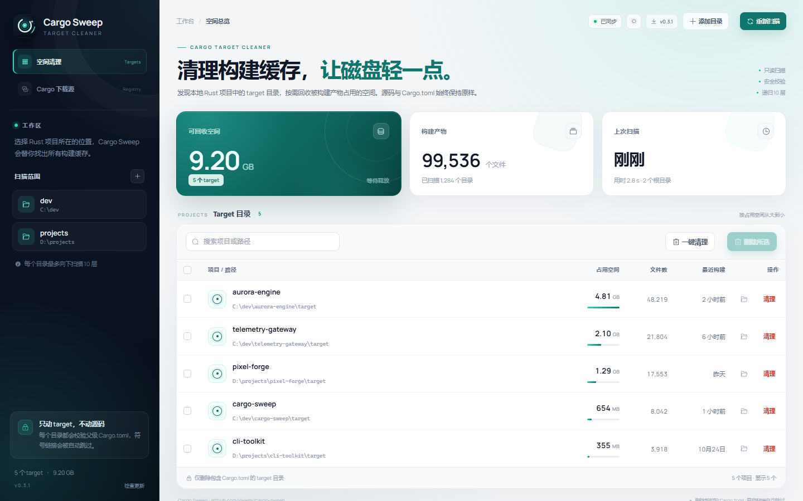
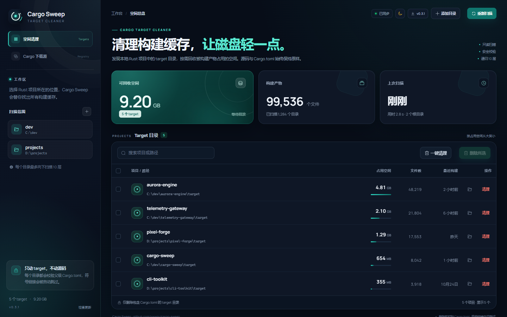
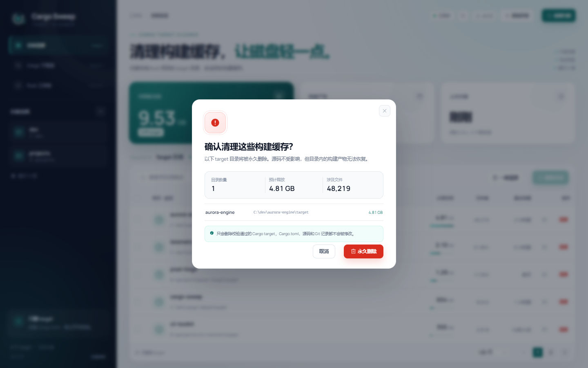
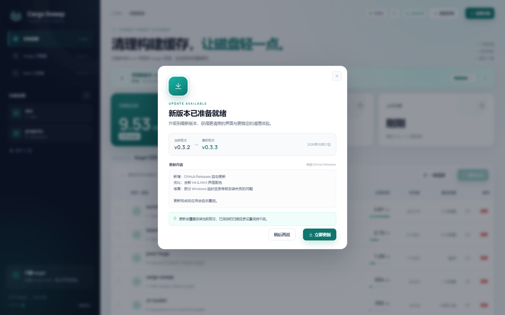
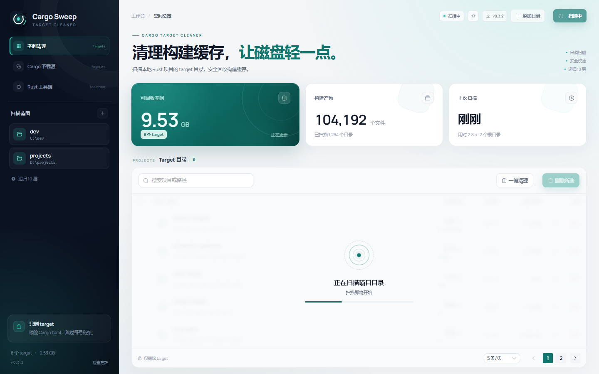
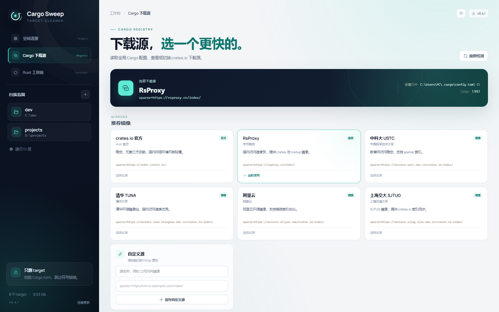
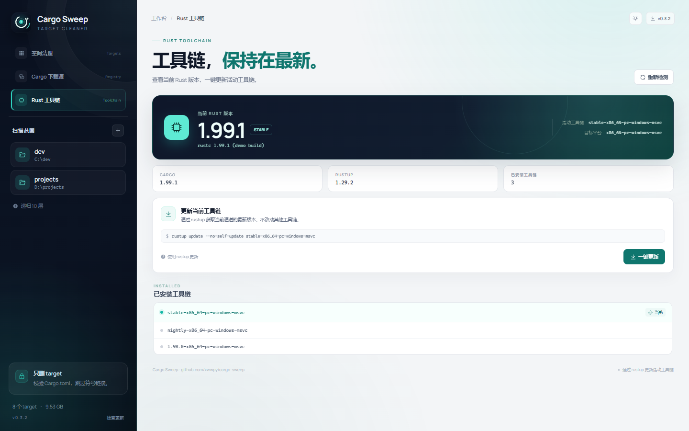
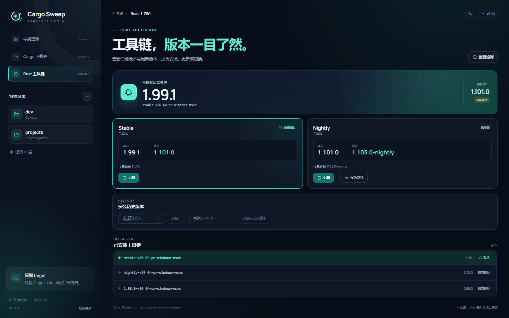

# Cargo Sweep

> 检测 Rust 项目的 `target` 目录占用，并按需安全地回收磁盘空间。

[](https://github.com/xwwpy/cargo-sweep/actions/workflows/release.yml)

Cargo Sweep 是一个基于 Tauri 2 的桌面应用。它会遍历你指定的工作目录，找出 Cargo
生成的 `target` 文件夹，统计其中的文件数量与真实文件大小，并支持单条删除、多选删除和
一键清理全部。

**[下载最新版本](https://github.com/xwwpy/cargo-sweep/releases/latest)** ·
[查看 Release](https://github.com/xwwpy/cargo-sweep/releases)



## 功能

- **Ink & Mint** 界面：深墨色侧栏、薄荷绿强调色与 Manrope 数字字体
- 主题切换：浅色、深色与跟随系统，选择会自动保存
- 多根目录扫描：自由添加 / 移除项目目录，每个根目录最多递归 10 层
- 自动发现：识别目录名严格为 `target` 且父目录存在 `Cargo.toml` 的 Cargo 构建目录
- 可视化统计：可回收空间、文件总数、target 数量、上次扫描耗时
- 按项目查看：项目名、完整 target 路径、占用空间、文件数、最近构建时间
- 一键打开：在文件资源管理器中直接打开选中的 target 目录
- 清爽路径：自动移除 Windows 规范化路径的 `\\?\` 前缀
- Cargo 源管理：自动检测当前全局下载源，内置常见镜像并支持自定义源
- 快速筛选：按项目名或路径实时搜索
- 分页浏览：每页 5 / 10 / 20 项，多选状态可跨页保留
- Rust 工具链：显示当前 rustc、Cargo、rustup 版本与活动工具链，支持一键更新
- 三种清理方式：
  - 单条「清理」
  - 勾选多条后「删除所选」
  - 「一键清理」全部已发现目录
- 扫描进度与后台线程：Rust 侧阻塞扫描不会卡住界面
- 二次确认：删除前展示目录数、预计释放空间、涉及文件数及路径预览
- 原生目录选择器：通过 Tauri Dialog 插件选择扫描范围
- **GitHub Releases 自动更新**：启动后台检查、手动检查、下载进度与自动重启

## 平台支持

| 平台 | 安装包 | 自动更新 |
| --- | --- | --- |
| Windows 10 / 11 x64 | NSIS 安装包、免安装版 | 支持 |
| macOS 10.15+（Intel / Apple Silicon） | 通用 DMG | 支持 |
| Linux x86_64 | DEB、AppImage | 支持 |

Linux DEB 使用 Ubuntu 24.04 的 WebKitGTK 4.1 构建，适用于 Ubuntu 24.04+ 及兼容发行版；
其他发行版可以直接使用 AppImage。

## 界面

| 浅色主题 | 深色主题 |
| --- | --- |
|  |  |

| 清理确认 | 自动更新 |
| --- | --- |
|  |  |

| 扫描进行中 | Cargo 下载源 |
| --- | --- |
|  |  |

| Rust 工具链 | 深色工具链 |
| --- | --- |
|  |  |

> 截图使用浏览器演示模式与内置演示数据，不代表本机真实项目路径。

## 技术栈

| 层 | 技术 |
| --- | --- |
| 桌面壳 | Tauri 2 |
| 平台 | Windows 10/11、macOS 10.15+、Linux x86_64 |
| 后端 | Rust 2021、WalkDir、Rayon、Toml、toml_edit |
| 前端 | Vue 3 + TypeScript + Vite 8 |
| 组件库 | Element Plus 2 |
| 字体 | Manrope Variable |
| 更新 | `tauri-plugin-updater` + `tauri-plugin-process` + GitHub Releases |

### 关于 Element UI

`element-ui` 只支持 Vue 2。本项目使用 Vue 3，因此采用 Element Plus，它是 Element UI
的官方 Vue 3 版本，组件 API 与视觉体系与 Element UI 一脉相承。

## 本地开发

### 环境要求

- Node.js >= 20.19（推荐 22 或更高）
- pnpm 10+
- Rust >= 1.90
- Windows 需要 WebView2 Runtime 与 MSVC Build Tools
- macOS 需要 Xcode Command Line Tools
- Linux 需要 WebKitGTK 4.1、AppIndicator、librsvg、patchelf 等 Tauri 构建依赖（命令见下文）

### 启动开发模式

```bash
pnpm install
pnpm tauri dev
```

Tauri 会自动启动 Vite，并打开原生窗口。

### 仅预览前端

```bash
pnpm dev
```

打开 <http://localhost:1420/?demo=1> 可预览完整界面；加上 `&update=1` 可预览更新提示与
更新弹窗。演示模式不会读取或修改任何真实文件，也不会执行安装。

### 构建

Windows：

```bash
pnpm tauri build --bundles nsis
```

产物位于 `src-tauri/target/release/bundle/nsis/`。

macOS 通用包（Intel + Apple Silicon）：

```bash
rustup target add aarch64-apple-darwin x86_64-apple-darwin
pnpm tauri build --target universal-apple-darwin --bundles app,dmg
```

产物位于 `src-tauri/target/universal-apple-darwin/release/bundle/dmg/`。

Linux：

```bash
sudo apt install libwebkit2gtk-4.1-dev libayatana-appindicator3-dev \
  librsvg2-dev patchelf libxdo-dev libssl-dev
pnpm tauri build --bundles deb,appimage
```

产物位于 `src-tauri/target/release/bundle/deb/` 和
`src-tauri/target/release/bundle/appimage/`。

自动更新产物需要签名密钥；CI 会从 `TAURI_SIGNING_PRIVATE_KEY` Secret 读取。本地构建示例：

```bash
export TAURI_SIGNING_PRIVATE_KEY="$(cat .secrets/cargo-sweep-updater.key)"
pnpm tauri build --bundles deb,appimage
```

构建后会生成 NSIS `.exe.sig`、macOS `.app.tar.gz.sig`、Linux `.deb.sig` 与
`.AppImage.sig`。更新私钥绝不能提交到仓库。

## 自动更新

- 更新源：<https://github.com/xwwpy/cargo-sweep/releases/latest/download/latest.json>
- 应用启动约 3 秒后静默检查一次更新，底部版本号与顶栏版本胶囊可手动检查
- 发现新版本后展示更新横幅；弹窗中可查看版本、发布日期和 Release Notes
- 下载、签名校验、安装由 Tauri Updater 完成，安装完成后自动重启
- `latest.json` 同时包含 Windows NSIS、macOS 通用包与 Linux AppImage 的更新条目
- 更新包使用 minisign 签名，公钥固定在 `src-tauri/tauri.conf.json` 中
- 签名私钥保存为 GitHub Actions Secret：`TAURI_SIGNING_PRIVATE_KEY`
- Linux DEB 更新会通过 `pkexec` / `sudo` 安装，可能需要输入系统密码

### 发布新版本

1. 同步修改 `package.json`、`src-tauri/Cargo.toml`、`src-tauri/tauri.conf.json` 与
   `src/lib/version.ts` 的版本号。
2. 在 `CHANGELOG.md` 顶部添加当前版本的小节，只写这次的新功能和 Bug 修复。发布流程只会
   提取当前版本的小节，不会把历史功能重复写进新 Release。
3. 提交代码并推送标签：

```bash
git add .
git commit -m "release: v0.4.0"
git tag v0.4.0
git push origin main --tags
```

4. GitHub Actions 会依次完成：
   - Windows：签名 NSIS 安装包、Windows 临时目录修复脚本与免安装版
   - macOS：签名更新归档与通用 DMG
   - Linux：签名 AppImage 更新归档、DEB 与 AppImage
   - 汇总所有平台资产，生成跨平台 `latest.json` 与 `SHA256SUMS.txt`

> 如果私钥丢失，已发布版本将无法再收到更新。请把私钥和密码（如有）备份到安全位置。

## Cargo 下载源管理

侧栏的「Cargo 下载源」页面会自动读取全局 Cargo 配置（默认
`%USERPROFILE%\.cargo\config.toml`，也支持 `CARGO_HOME`），解析
`[source.crates-io] replace-with` 并展示当前实际使用的索引。

内置镜像：

- crates.io 官方
- RsProxy
- 中科大 USTC
- 清华 TUNA
- 阿里云
- 上海交大 SJTUG

切换时会使用 `toml_edit` 只修改 `[source.crates-io]` 和 Cargo Sweep 管理的
`[source.cargo-sweep-managed]`，保留其他 Cargo 配置与注释；写入前自动生成
`config.toml.cargo-sweep-backup-<时间戳>` 备份。页面也支持填写自定义
`sparse+https://` 或 `https://` 索引地址，并将自定义项保存在本地。

> 此处只修改全局配置。项目内的 `.cargo/config.toml` 优先级更高；如果项目目录中有单独
> 配置，它可能会覆盖这里的选择。

## 使用方式

顶栏右侧的主题按钮支持「浅色 / 深色 / 跟随系统」，选择会自动保存，下次启动继续使用。

1. 首次启动时会自动添加常见目录，例如“文档”“桌面”及 `source/repos`、`projects` 等。
2. 点击左侧「扫描范围」旁的 `+`，或右上角「添加目录」，选择 Rust 项目所在目录。
3. 扫描完成后，在列表中查看各 `target` 的占用空间。
4. 点击项目行右侧的目录图标，可以直接打开对应的 target 目录。
5. 点击单行的「清理」，或勾选多行后点击「删除所选」，也可以直接「一键清理」。
6. 在确认弹窗中检查目录与预计释放空间，确认后执行删除。
7. 打开侧栏「Cargo 下载源」，检测当前源，选择镜像或自定义源后应用切换。
8. 打开侧栏「Rust 工具链」，查看当前版本，需要时点击「一键更新」。

下次执行 `cargo build` 时，Cargo 会按需重新生成 `target`，不会影响源码。

## 下载与安装

Release 会同时提供 Windows、macOS 和 Linux 安装包。下载地址：

<https://github.com/xwwpy/cargo-sweep/releases/latest>

### Windows

- `Cargo-Sweep-<version>-installer-x64.zip`
- `Cargo-Sweep-<version>-portable-x64.zip`

**不要直接双击原始 setup.exe。** 部分 Windows 环境的 `TEMP` / `TMP` 指向 NSIS 无法写入的
目录（例如 `E:\Temp`），会提示：

```text
NSIS Error
Error writing temporary file. Make sure your temp folder is valid.
```

安装包内的 `INSTALL-CARGO-SWEEP.cmd` 会把临时目录切换到安装包旁边的 `temp/` 后再启动
安装器，安装结束后自动清理。免安装版请双击 `START-CARGO-SWEEP.cmd`，它同样会设置独立的
临时目录和 WebView2 数据目录。

如果启动后没有出现窗口，可检查：

```text
%LOCALAPPDATA%\CargoSweep\logs\startup.log
```

安装包未做代码签名，Windows 可能提示“未知发布者”；请选择“更多信息 → 仍要运行”。

### macOS

下载通用 DMG：

```text
Cargo-Sweep-<version>-universal.dmg
```

安装步骤：

1. 打开 DMG：

```bash
open ~/Downloads/Cargo-Sweep-<version>-universal.dmg
```

2. 将 **Cargo Sweep** 拖入「应用程序」文件夹。
3. 首次启动时如果提示无法验证开发者，请在 Finder 中右键点击 Cargo Sweep，选择「打开」。

安装包未做 Apple 代码签名与公证。如果仍被 Gatekeeper 拦截，可以清除隔离属性：

```bash
xattr -dr com.apple.quarantine "/Applications/Cargo Sweep.app"
```

### Linux

下载 DEB：

```text
Cargo-Sweep-<version>-amd64.deb
```

在下载目录执行：

```bash
cd ~/Downloads
sudo apt install ./Cargo-Sweep-<version>-amd64.deb
```

`apt install ./xxx.deb` 会自动安装 WebKitGTK 等依赖。如果当前发行版的 `apt` 不接受本地
DEB，可改用：

```bash
sudo dpkg -i ./Cargo-Sweep-<version>-amd64.deb
sudo apt-get install -f
```

安装后可以从应用菜单启动，或在终端运行：

```bash
cargo-sweep
```

卸载：

```bash
sudo apt remove cargo-sweep
```

如果不使用 DEB，也可以下载便携版 AppImage：

```bash
chmod +x Cargo-Sweep-<version>-amd64.AppImage
./Cargo-Sweep-<version>-amd64.AppImage
```

DEB 使用 Ubuntu 24.04 的 WebKitGTK 4.1 构建，建议在 Ubuntu 24.04+ 或兼容发行版安装；
其他发行版可以优先使用 AppImage。DEB 与 AppImage 均支持自动更新，DEB 更新时系统会请求
管理员权限。

## 安全设计

删除是不可恢复的操作，因此校验放在 Rust 后端完成，而不是只信任前端：

- 只允许删除目录名严格为 `target` 的目录
- 父目录必须存在 `Cargo.toml`
- 拒绝符号链接形式的 `target`
- 删除前对路径做 `canonicalize`，并再次校验父级 `Cargo.toml`
- 不会删除根目录、项目目录、`Cargo.toml` 或任何源码文件
- Windows 删除失败时，会尝试清除只读属性后再重试
- 扫描不跟随目录符号链接，避免越界读取
- 扫描时跳过 `.git`、`node_modules`、`AppData`、回收站等目录
- 前端一次最多提交 512 个删除路径，后端逐条重新校验

自动更新同样有安全边界：

- 更新清单与安装包均通过 HTTPS 获取
- 安装包必须通过内置公钥的 minisign 签名校验
- 更新私钥只存在于本地安全目录和 GitHub Actions Secret 中

> 不要在 `cargo build` / `cargo test` 正在写入同一 target 时执行清理。删除失败时应用会
> 报告错误，不会静默忽略。

## 后端命令与插件

| 命令 | 作用 |
| --- | --- |
| `default_scan_roots` | 返回首次启动时建议的扫描目录 |
| `scan_targets` | 扫描根目录，返回 target 列表、文件数、大小和耗时，并发送进度事件 |
| `delete_targets` | 校验并删除指定 target，返回释放空间与失败列表 |
| `detect_cargo_source` | 读取全局 Cargo 配置并解析当前下载源 |
| `apply_cargo_source` | 备份并切换 Cargo 下载源 |
| `detect_rust_toolchain` | 读取 rustc、Cargo、rustup 与工具链信息 |
| `update_rust_toolchain` | 通过 rustup 更新当前工具链 |
| `open_folder` | 在系统文件管理器中打开指定目录 |

前端通过 Tauri 事件 `scan-progress` 接收扫描阶段、当前根目录和已发现数量。

## 项目结构

```text
cargo-sweep/
├─ .github/workflows/release.yml  # 标签触发的 Windows / macOS / Linux 发布
├─ CHANGELOG.md                   # 每个版本仅记录当次功能与修复
├─ src/
│  ├─ App.vue                     # 页面状态、扫描、清理与更新入口
│  ├─ api.ts                      # Tauri invoke / 事件 / 目录选择封装
│  ├─ composables/useTheme.ts     # 主题状态、系统跟随与本地持久化
│  ├─ composables/useUpdater.ts   # 检查、下载、安装与重启
│  ├─ components/
│  │  ├─ SidebarPanel.vue         # 页面导航、扫描范围与更新入口
│  │  ├─ SummaryCards.vue         # 空间、文件、最近扫描统计
│  │  ├─ TargetTable.vue          # 搜索、多选、打开目录与清理
│  │  ├─ DeleteDialog.vue         # 删除确认
│  │  ├─ CargoSourcePage.vue      # 下载源检测、切换与自定义
│  │  ├─ RustToolchainPage.vue    # 版本展示与工具链更新
│  │  ├─ UpdateBanner.vue         # 新版本横幅
│  │  └─ UpdateDialog.vue         # 更新详情与下载进度
│  ├─ lib/format.ts               # 字节、时间和路径格式化
│  ├─ theme-dark.css              # 深色主题覆盖样式
│  └─ styles.css                  # Ink & Mint 主题
├─ packaging/                     # 发布包说明与启动脚本模板
├─ scripts/package-release.ps1    # Windows 安装包 / 免安装版打包
├─ scripts/release-notes.mjs      # 从 CHANGELOG 提取当前版本发布说明
├─ scripts/generate-latest-json.mjs # 汇总三平台签名与更新清单
├─ src-tauri/
│  ├─ src/scanner.rs              # 扫描、测量、校验、删除与单元测试
│  ├─ src/cargo_source.rs         # Cargo 源检测、备份与切换
│  ├─ src/rust_toolchain.rs       # Rust 版本检测与 rustup 更新
│  ├─ src/lib.rs                  # Tauri 命令与插件注册
│  ├─ tauri.conf.json             # 更新源与签名公钥
│  └─ capabilities/default.json
├─ docs/                          # 界面截图
└─ app-icon.svg                   # 应用图标源文件
```

## 检查与测试

```bash
# 前端类型检查 + 生产构建
pnpm build

# Rust 格式化、静态检查与测试
cd src-tauri
cargo fmt --all -- --check
cargo clippy --all-targets -- -D warnings
cargo test --lib
```

Rust 测试覆盖了 target 识别、嵌套 target 跳过、测量、拒绝非 Cargo target、拒绝非 target
目录以及真实删除等场景。

## 已知边界

- 只扫描项目内的 `target`。通过 `CARGO_TARGET_DIR` 或 Cargo 配置放到项目外的自定义构建
  目录不会自动关联到项目；可以把那个目录所在位置作为扫描根目录手动添加。
- 文件大小按文件逻辑长度汇总（1024 进制），与资源管理器显示的“占用空间”可能因磁盘簇
  大小略有差异。
- 根目录扫描深度上限为 10 层；更深的项目可以直接把项目目录添加为扫描根。
- 当前没有检测正在运行的 Cargo 进程；清理时请避免同时构建。
